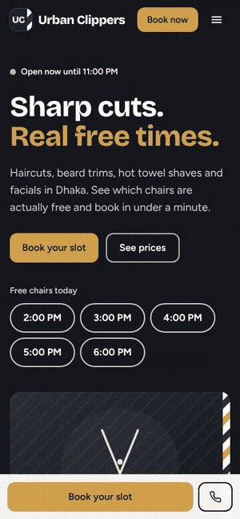

# Urban Clippers

A booking website for a men's grooming studio in Dhaka. Visitors pick services, a date and a free start time, and get a confirmed booking with their barber's name. The shop gets an admin panel to run the day.

> Portfolio project by Shafiq Rahman Adi. The business, prices and contact details are fictional. Bookings are not real.

**Live demo:** _add your Netlify link here_  
**Demo accounts:** the login page has two labelled buttons, "Demo client" and "Demo admin". Demo data is reset every night.



## What it does

**For customers**
- Choose one or more services, then a date, then a start time. Times that are taken are greyed out, not hidden.
- Book as a guest (name and mobile number) or with an account. The same booking engine serves both.
- A confirmation page with the barber's name, add-to-calendar, WhatsApp share, reschedule and cancel.
- Guests find their booking again with the booking code plus the phone number.
- Live "Open now" badge, price list, gallery, location and FAQ.

**For the shop (admin)**
- Day schedule grouped by barber, with Completed, No-show and Cancel buttons and search by phone, name or code.
- Add walk-in bookings (same transaction and same protection as online ones).
- Barber availability grid: uncheck a barber for a day. If that barber already has bookings, the system moves them to a free barber, or refuses and lists the ones it could not move.
- Edit services, prices and opening hours.

## How double-booking is prevented

Clients never choose a barber; the system assigns whoever is free. That makes the database, not the web page, the source of truth.

1. Every live booking owns one row in `booking_slots` with a **UNIQUE key on (barber_id, slot_date, slot_time)**.
2. To book, the server picks a free barber (fewest bookings that day first) and, **inside one transaction**, inserts the booking, its slot row and its services.
3. If another request got that barber a moment earlier, the database rejects the slot row with a duplicate-key error. The transaction rolls back and the server tries the next free barber.
4. If every barber is taken, the customer sees "That time was just taken. Pick another time." and keeps everything they typed.
5. Cancelling deletes the slot row, which frees the slot for someone else.

The list of free times is a convenience. The UNIQUE key is the guarantee. `npm run test:booking` proves it: 8 simultaneous requests for one time with 4 barbers produce exactly 4 bookings and 4 refusals, and a raw SQL duplicate insert is rejected by the database itself.

Each booking reserves one visit window per barber (60 minutes), and extras such as a facial fit inside it. Duration-aware scheduling is a possible extension.

## Stack

Next.js (App Router), TypeScript, Tailwind CSS, MySQL-compatible database (`mysql2`, raw parameterized SQL), `zod` validation, `bcryptjs` and signed `jose` cookies for sessions. Hosted on Netlify with a free TiDB Cloud database.

## Security notes

- Every query is parameterized; every input is validated server-side with zod.
- Passwords are hashed with bcrypt. Sessions are signed, HTTP-only, secure cookies.
- Rate limiting (stored in the database, so it works on serverless hosts) on login, registration, booking and lookup.
- Booking lookups return the same message for a wrong code and a wrong phone number.
- Admin pages and `/api/admin/*` check the role on the server.
- Security headers and a Content Security Policy on every response.
- The nightly reset endpoint needs a secret.

## Run it locally

Run these in the project folder (`urban-clippers/`). You need Node 20 or newer and a MySQL or MariaDB server.

```bash
npm install
cp .env.example .env.local
```

Edit `.env.local` with your database details (use `DB_SSL=false` for a local database), then:

```bash
npm run db:setup
npm run dev
```

Open http://localhost:3000. `db:setup` creates the tables and loads demo data (4 barbers, 12 services, a realistic schedule for the next days).

| Command | What it does |
|---|---|
| `npm run dev` | Start the dev server |
| `npm run build` / `npm start` | Production build and server |
| `npm run db:setup` | Create tables and load demo data (safe to repeat) |
| `npm run db:reset` | Reset demo data only |
| `npm run test:booking` | Race and edge-case tests against your database |
| `npm run typecheck` / `npm run lint` | Static checks |
| `npm run record` | Record the portfolio walkthrough video |

## Deploy

See [docs/DEPLOY.md](docs/DEPLOY.md) for the free setup (TiDB Cloud + Netlify + GitHub Actions) step by step, and [docs/PHOTOS.md](docs/PHOTOS.md) for replacing the placeholder images.

## Project layout

```
db/schema.sql            tables and the UNIQUE guard
src/lib/engine.ts        booking, cancel, reschedule, reassign, barber days off
src/lib/availability.ts  which start times are free
src/lib/demo-reset.ts    nightly demo reset
src/app/api/             route handlers (public, auth, admin, cron)
src/app/(site)/          public pages and booking flow
src/app/admin/           admin panel
scripts/                 db setup, tests, recorder
```
